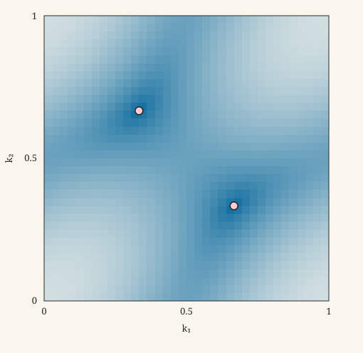

What survives of the exactly solvable Kitaev spin liquid when a magnetic field, a defect, or additional interactions prevent an exact solution? The open-source project [**kitaev-mf**](https://github.com/lufreitas0000/kitaev-mf) approaches this question through a self-consistent Majorana mean-field approximation, combining analytical structure with reproducible numerical calculations.

The first stage concentrates on the ferromagnetic Kitaev honeycomb model in a magnetic field along $[111]$: establishing the algebra, constructing the Gaussian mean-field states, and determining when numerical solvers can be trusted. From there, the program turns to low-energy excitations, vortices, dynamical response, and models outside the integrable limit. The distinction between **a converged calculation** and **a controlled physical approximation** guides the work throughout.

## From spins to a Majorana mean-field state {#majorana}

The honeycomb Kitaev interaction couples a different spin component on each bond. With Pauli operators $\sigma_i^\gamma$ and a choice of exchange-sign convention, the spin Hamiltonian can be written as

$$
H_K=\sum_{\langle ij\rangle_\gamma}K_\gamma\,\sigma_i^\gamma\sigma_j^\gamma,
\qquad
H=H_K-\sum_{i,\gamma}h_\gamma\sigma_i^\gamma .
$$

At zero field, the Kitaev representation introduces four Majorana operators $c_i^\mu$ per site, obeying $\{c_i^\mu,c_j^\nu\}=2\delta_{ij}\delta^{\mu\nu}$. The representation enlarges the Hilbert space: local physical-state projection is essential. In the integrable model, one can choose a static $\mathbb{Z}_2$ gauge sector and solve a quadratic Hamiltonian for the remaining matter Majoranas. Generic magnetic fields couple the matter and gauge degrees of freedom, so the same exact reduction no longer applies.

The mean-field approximation restricts the state to a **quasifree (Gaussian) fermionic family**. Within this family, Wick's theorem expresses higher even correlations in terms of two-point functions. This is a property of the chosen states, *not* an operator identity for the original interacting Hamiltonian. The calculation is parametrized by directed-bond covariances $U_{ij}^{\mu\nu}$, on-site covariances $V_i^{\mu\nu}$, and multipliers $\lambda_i^\gamma$ for the local constraints. In the conventions of the project's labbook,

$$
U_{ij}^{\mu\nu}=-i\langle c_i^\mu c_j^\nu\rangle_{\mathrm G},
\qquad
V_i^{\mu\nu}=-i\langle c_i^\mu c_i^\nu\rangle_{\mathrm G}
\quad(\mu\ne\nu).
$$

The superscript $\mathrm G$ indicates a Gaussian state. Bond orientation, the sign convention of the spin–Majorana representation, and the normalization of exchange couplings must remain consistent when comparing calculations.

## Self-consistency as a nonlinear spectral problem {#fixed-point}

Collect the independent mean-field variables into $X=(U,V,\lambda)$. They determine a quadratic Hamiltonian $H_{\mathrm{MF}}[X]$, whose occupied single-particle states produce new covariances. Updating the constraints alongside these covariances defines a nonlinear map

$$
\Phi:\mathcal X\longrightarrow\mathcal X,
\qquad
R(X)=\Phi(X)-X,
\qquad
R(X_*)=0.
$$

For a gapped zero-temperature Bloch Hamiltonian, the underlying covariance update can be expressed using its occupied spectral projector,

$$
\Pi_X^-(\mathbf k)
=\mathbf 1_{(-\infty,0)}
\bigl(\mathcal H_{\mathrm{MF}}(\mathbf k;X)\bigr).
$$

At zero modes or finite-size level crossings, occupations and physical parity require additional care. The simplest solver repeats $X_{n+1}=\Phi(X_n)$ (Picard iteration). Damping instead uses $X_{n+1}=X_n+\alpha R(X_n)$, where $0<\alpha\le1$. Local linear convergence is governed by the derivative of the iteration map; neither damping nor convergence is guaranteed throughout the full parameter space.

The code also investigates **Anderson acceleration / DIIS**, **Broyden updates**, and **Jacobian-free Newton–Krylov** methods. DIIS combines a history of residuals; Broyden approximates the inverse response of $R$; limited-memory variants avoid storing a dense Jacobian. In large real-space problems, evaluating $\Phi$ itself is expensive, motivating real skew-symmetric linear algebra and matrix-sign purification of Gaussian covariances. Near a vanishing spectral gap, these spectral algorithms need conditioning and zero-mode safeguards.

Finding $R(X_*)\simeq0$ does **not** prove that $X_*$ is the global minimum of the mean-field energy, that it satisfies every physical constraint, or that the Gaussian state accurately represents the interacting spin ground state. Multiple self-consistent solutions can coexist. Their energies, local stability, admissibility, and dependence on initial conditions must be examined separately.

## What can numerical benchmarks establish? {#benchmarks}

Three logically distinct questions must be tested.

**Is the calculation algebraically and numerically consistent?** The CAR normalization, antisymmetry of Majorana covariances, Hermiticity of the effective one-particle Hamiltonian, spectral sum rules, positivity constraints, and gauge/KKT residuals should survive changes in lattice size and solver. A small fixed-point residual alone is insufficient.

**Does the approximation reproduce a result known independently?** In the zero-field, flux-free isotropic Kitaev limit, the matter dispersion is controlled by $f(\mathbf k)=1+e^{2\pi i k_1}+e^{2\pi i k_2}$. An exact integral provides a particularly useful bond-covariance benchmark:

$$
\bar U
=\frac13\int_0^1\!\!dk_1\int_0^1\!\!dk_2\,
\left|1+e^{2\pi i k_1}+e^{2\pi i k_2}\right|
\simeq 0.5248657458506.
$$

In the labbook's ferromagnetic, flux-free gauge convention, $U_b^{00}=-\bar U$. Other exact checks include band folding, the anisotropic one-dimensional zigzag limit, and isolated-bond dimers.

<figure id="kmf-ubar" class="kmf-island" aria-labelledby="kmf-ubar-caption">
<figcaption id="kmf-ubar-caption">Exact-limit check: numerical quadrature for Ū</figcaption>

The midpoint rule approximates the integral above on an N × N grid, with ka = (na + 1/2)/N. It is a numerical approximation to a known exact-limit quantity, not a mean-field solver benchmark.

<table>
<thead><tr><th scope="col">N</th><th scope="col">Midpoint Ū</th><th scope="col">Absolute difference</th></tr></thead>
<tbody>
<tr><td>8</td><td>0.5248951470</td><td>2.94 × 10−5</td></tr>
<tr><td>16</td><td>0.5248532248</td><td>1.25 × 10−5</td></tr>
<tr><td>32</td><td>0.5248651506</td><td>5.95 × 10−7</td></tr>
<tr><td>64</td><td>0.5248656070</td><td>1.39 × 10−7</td></tr>
<tr><td>128</td><td>0.5248657324</td><td>1.34 × 10−8</td></tr>
</tbody>
</table>

<label for="kmf-ubar-N">Compute another midpoint approximation: </label>
<select id="kmf-ubar-N"><option>8</option><option>16</option><option>32</option><option selected>64</option><option>96</option><option>128</option><option>256</option></select>

Reference Ū = 0.5248657458506. The error need not decrease monotonically with N; the integral has zeros where |f| is not smooth. The static table remains visible without JavaScript.

</figure>

 These constrain the implementation in special regimes; they do not establish the accuracy of an arbitrary finite-field mean-field solution.

<figure id="kmf-dispersion" class="kmf-island" aria-labelledby="kmf-dispersion-caption">
<figcaption id="kmf-dispersion-caption">Zero-field structure factor: dimensionless r = |f(k)|</figcaption>

Jx = Jy = J; vary 0 ≤ Jz ≤ 2J. The static view shows Jz = J. Colors share the fixed range r = 0–4.

<canvas width="510" height="495" role="img" aria-label="Dimensionless r = |f| heatmap" hidden></canvas>

<label for="kmf-jz-ratio">Jz/J: <output for="kmf-jz-ratio">1.00</output></label>
<input id="kmf-jz-ratio" type="range" min="0" max="2" step="0.02" value="1" aria-describedby="kmf-dispersion-readout">

Exact zero-field flux-free structure factor, not the finite-field mean-field excitation energy.

</figure>

**Is a physical prediction robust?** Compare independent initial states and solver families, scan system size and boundary conditions, inspect competing stationary branches, and check observables against perturbation theory or exact diagonalization where possible. Spin-correlation sum rules and physically projected flux/parity sectors matter as much as convergence speed. An approximation without a uniform error bound remains uncontrolled even after excellent numerical validation.

The project's [Living Lab Book](https://lufreitas0000.github.io/kitaev-mf/kitaev-mf-labbook.pdf) develops these checks in detail, from covariance positivity and spectral projectors to fixed-point basins and real-space purification. Its numerical tables are *regime-specific evidence*, not universal solver rankings or proofs of physical accuracy.

## Physics beyond the integrable limit {#directions}

**Exact perturbation theory versus mean field.** A weak magnetic field generates an effective chiral interaction at third order, schematically of order $h_xh_yh_z$. In exact spin perturbation theory, intermediate states involve changed flux sectors and the physical Hilbert-space projection. In a Gaussian mean-field calculation, the intermediate excitations and self-consistent responses differ. Comparing coefficients therefore requires matching conventions, spectral thresholds, and the relevant resolvents; replacing a denominator by a single flux-gap estimate is not an exact derivation.

**Low-energy physics of the Kitaev spin liquid.** The zero-field matter sector has Dirac points. Weak fields, vortices, and boundaries introduce questions about induced gaps, bound modes, spin correlations, and their observable signatures. The project's longer-term dynamical program will compare exact gauge-quench spin correlators with their mean-field counterparts, including the tunneling response associated with vortex-bound Majorana modes.

**Other phases and solvable limits.** The anisotropic chains and decoupled dimers supply exact benchmark corners. High-field polarization supplies a different asymptotic reference, but a generic finite-field honeycomb model is not made exactly solvable by being close to that limit. Extending the method to other couplings and phases requires separate analysis of the relevant low-energy degrees of freedom and the validity of the Gaussian ansatz; a converged solution by itself cannot classify a phase.

**Numerical methods as a research question.** Beyond computing a phase diagram, the project asks which fixed-point algorithms remain reliable near competing phases, small gaps, vortices, disorder, or large real-space systems. One must separate iteration count from wall-clock cost, local convergence from basin reliability, and solver failure from a genuine physical instability.

## Further notes in this series {#series}

The topics below are planned as **separate, self-contained articles**. Links will be added when each article is written, checked, and published; no empty note pages are exposed.

| Theme | Planned article |
| --- | --- |
| Exact reference | Exact Kitaev spectra, physical parity, and perturbative resolvents |
| Low-energy theory | Dirac matter, field-induced masses, and vortex excitations |
| Other regimes | Anisotropic chains, dimers, and polarized limits |
| Validation | When a converged Majorana mean field can be trusted |
| Numerics I | Fixed-point iteration and the map $\Phi$ |
| Numerics II | DIIS, Anderson, Broyden, and Newton–Krylov methods |
| Numerics III | Matrix-sign purification and large real-space lattices |
| Dynamics | Spin correlations, gauge quenches, and tunneling spectroscopy |

**Further reading:** [project source code](https://github.com/lufreitas0000/kitaev-mf) · [Living Lab Book (PDF)](https://lufreitas0000.github.io/kitaev-mf/kitaev-mf-labbook.pdf) · [project roadmap](https://github.com/lufreitas0000/kitaev-mf/blob/main/doc/MILESTONE_ROADMAP.md) · [exact-perturbation research notes](https://github.com/lufreitas0000/kitaev-mf/tree/main/doc/rnd/exact-perturbation-theory).
