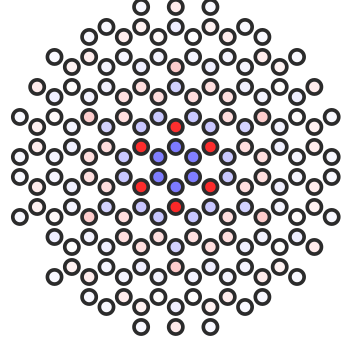

  

    
My interest in quantum many-body physics centers on how microscopic interactions and structural constraints organize collective behavior—connecting concrete lattice models in quantum spin systems and Kitaev spin liquids to emergent low-energy descriptions and mathematical principles that constrain which phases, excitations, and responses nature can support, while approaching science as social knowledge shaped by open reasoning and diverse perspectives.

    

      

        
<a href="research.html">Research →</a>

        
Published studies on vortex electric polarization, Majorana tunneling spectroscopy, magnetic quantum impurities, line defects, and UFRN theses.

      

      

        
<a href="notes/index.html">Feed →</a>

        
Unified blog feed collecting unpublished academic notes, reflections on academic and pop-culture texts, explanations of open-source projects on GitHub, and video scripts for <code>@lu.scientist</code>.

      

      

        
<a href="about.html">About Me &amp; CV →</a>

        
Mathematical and philosophical motivations, broader research horizons joining algebraic quantum field theory to quantum information and quantum matter, Lean 4 formalization, social and feminist epistemology, open-source projects, and my academic CV.

      

    

  

  <aside class="tufte-margin page-margin">
    

      
    

  </aside>

