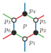
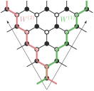
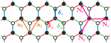
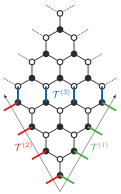
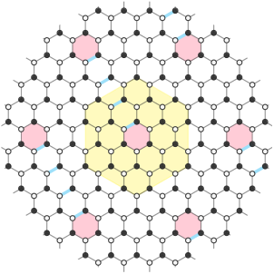

  <a href="#ch2-kitaev">Exact Kitaev Solution &amp; Gauge Fluxes</a>
  ·
  <a href="#ch3-micro">Microscopic Superexchange &amp; Polarization</a>
  ·
  <a href="#ch6-kmf">Real-Space Majorana Mean-Field</a>
  ·
  <a href="#ch7-vortices">Vortex Quadrupoles &amp; Local Bias</a>

This page hosts modular expository notes adapted from chapters of my PhD thesis (<em>Majorana mean-field theory with \(\mathbb{Z}_2\) vortices: Electrical tests in the extended Kitaev model</em>, UFRN, 2024) and MSc dissertation (<em>Gapless excitations in Kitaev materials with defects</em>, UFRN, 2019–2021), preserving the full labeled diagrams alongside multi-line aligned equations.

  

    <h2>Chapter 2 Note: Exact solution &amp; \(\mathbb{Z}_2\) gauge structure of the Kitaev honeycomb model</h2>
    
Expository Physics Note · Kitaev Honeycomb Model

    
On the honeycomb lattice with nearest-neighbor bond vectors \(\boldsymbol{\delta}_x, \boldsymbol{\delta}_y, \boldsymbol{\delta}_z\), the Kitaev Hamiltonian couples spin-\(1/2\) operators via bond-directional Ising interactions. Around each hexagonal plaquette \(p\) with vertices \((p_1, p_2, p_3, p_4, p_5, p_6)\), the plaquette operator \(W_p\) commutes with the Hamiltonian and partitions the Hilbert space into static \(\mathbb{Z}_2\) flux sectors (\(w_p = \pm 1\)):

$$\begin{aligned}
H_K &= -K_x \sum_{\langle ij \rangle_x} \sigma_i^x \sigma_j^x - K_y \sum_{\langle ij \rangle_y} \sigma_i^y \sigma_j^y - K_z \sum_{\langle ij \rangle_z} \sigma_i^z \sigma_j^z, \\[4pt]
W_p &= \sigma_{p_1}^x \sigma_{p_2}^y \sigma_{p_3}^z \sigma_{p_4}^x \sigma_{p_5}^y \sigma_{p_6}^z = \prod_{\langle ij \rangle_\gamma \in \partial p} (-i\,\hat{u}_{\langle ij \rangle_\gamma}).
\end{aligned}$$

Representing each spin by four Majorana fermions (\(\sigma_i^\alpha = i b_i^\alpha c_i\)) enlarges the Hilbert space from \(2^N\) to \(4^N\). Physical states must satisfy the local gauge projection \(D_i |\psi_{\text{phys}}\rangle = |\psi_{\text{phys}}\rangle\) with \(D_i = b_i^x b_i^y b_i^z c_i\), and on a torus of \(N = 2 L_1 L_2\) sites the global topological sector is additionally specified by two non-contractible Wilson loop operators \(W^{(1)}\) and \(W^{(2)}\).

  

  <aside class="tufte-margin page-margin">
    

      
      
Hexagonal plaquette \(p\) with sites \(p_1 \dots p_6\) and bond-directional \(x\), \(y\), \(z\) links.

    

    

      
      
Non-contractible topological Wilson loop paths \(W^{(1)}\) and \(W^{(2)}\) across the honeycomb cluster.

    

  </aside>

  

    <h2>Chapter 3 Note: Microscopic \(t_{2g}^5\) superexchange &amp; effective electric polarization operator</h2>
    
Expository Physics Note · Spin–Orbit Superexchange

    
In edge-sharing \(d^5\) transition-metal compounds such as \(\alpha\text{-RuCl}_3\), crystal-field splitting and strong spin–orbit coupling isolate a Kramers doublet \(j_{\text{eff}} = 1/2\). Perturbative projection of the three-orbital Hubbard–Kanamori model to fourth order in hopping yields both the extended \(JK\Gamma\) spin Hamiltonian and the effective spin-dependent local charge operator \(\delta n_l\):

$$\begin{aligned}
\boldsymbol{\delta}_z &= \frac{\mathbf{a}_1 + \mathbf{a}_2}{3}, \qquad
\boldsymbol{\delta}_x = \frac{-2\mathbf{a}_1 + \mathbf{a}_2}{3}, \qquad
\boldsymbol{\delta}_y = \frac{\mathbf{a}_1 - 2\mathbf{a}_2}{3}, \\[4pt]
\delta n_l &= \sum_{\gamma \neq \gamma'} C_{\gamma\gamma'} \left( \mathbf{S}_l \cdot \mathbf{S}_{l+\boldsymbol{\delta}_\gamma} \right) + \text{anisotropic three-site virtual-hopping terms}.
\end{aligned}$$

Consistency requires applying the same low-energy projection to both the Hamiltonian and the electromagnetic current/density operators before evaluating inhomogeneous expectation values around defects or vortices.

  

  <aside class="tufte-margin page-margin">
    

      
      
Bravais lattice vectors \(\mathbf{a}_{1,2}\), nearest-neighbor vectors \(\boldsymbol{\delta}_{x,y,z}\), and boundary normals \(\mathbf{N}_{x,y,z}\).

    

  </aside>

  

    <h2>Chapter 6 Note: Real-space Majorana mean-field theory &amp; boundary operators on the torus</h2>
    
Expository Physics Note · Inhomogeneous Bogoliubov–de Gennes Formalism

    
Away from the integrable Kitaev point (\(J, \Gamma, \mathbf{h} \neq 0\)), the \(\mathbb{Z}_2\) gauge field acquires dynamics. In the four-Majorana representation \(c_i^\mu = (c_i^0, c_i^x, c_i^y, c_i^z)\), we decouple the two-body spin interactions in real space via self-consistent bond parameters \(U_{ij}^{\mu\nu} = \langle i c_i^\mu c_j^\nu \rangle\) and on-site magnetizations \(V_i^{\mu\nu} = \langle i c_i^\mu c_i^\nu \rangle\) across a finite \(L_1 \times L_2\) torus with boundary link operators \(\mathcal{T}^{(1)}, \mathcal{T}^{(2)}, \mathcal{T}^{(3)}\).

  

  <aside class="tufte-margin page-margin">
    

      
      
Boundary link configurations \(\mathcal{T}^{(1)}\), \(\mathcal{T}^{(2)}\), and interior link \(\mathcal{T}^{(3)}\).

    

  </aside>

  

    <h2>Chapter 7 Note: \(\mathbb{Z}_2\) vortices, quadrupole interactions &amp; local electrostatic bias</h2>
    
Expository Physics Note · Vortex Electrostatics &amp; Quadrupole Tensor

    
Inserting a \(\mathbb{Z}_2\) vortex configuration (\(W_p = -1\) on selected plaquettes connected by strings of flipped gauge links \(U_{ij}^{\gamma\gamma} \to -U_{ij}^{\gamma\gamma}\)) into the self-consistent Bogoliubov–de Gennes loop resolves the spatial decay of the induced charge density \(\langle \delta n_l \rangle\) around each vortex core and determines the quadrupole tensor \(Q_{\alpha\beta}(\mathbf{h})\) and the vortex energy gap \(\Delta_v(V_0)\) under a localized electrostatic potential.

  

  <aside class="tufte-margin page-margin">
    

      
      
Symmetric honeycomb cluster with a central \(\mathbb{Z}_2\) vortex (#FFCCD7) and flipped gauge strings (light blue).

    

  </aside>

