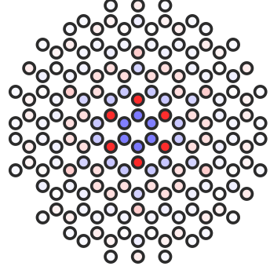
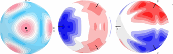
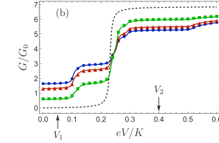
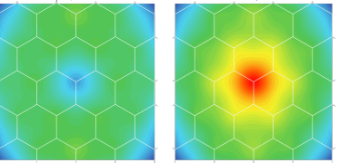
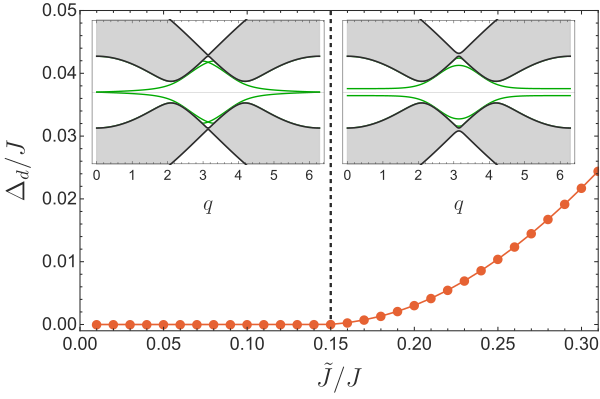

My published research examines how microscopic interactions, local perturbations, and gauge or symmetry constraints govern low-energy excitations and their physical responses in quantum spin systems. Open follow-up questions and self-contained expository derivations from my PhD and MSc research live on the <a href="notes/index.html">Feed</a> page.

  

    <h2>1. Electric polarization near vortices in the extended Kitaev model</h2>
    
L. R. D. Freitas, Tim Bauer, Reinhold Egger, and Rodrigo G. Pereira · <a href="https://doi.org/10.1038/s41535-024-00643-5">npj Quantum Materials 9, 33 (2024) · DOI: 10.1038/s41535-024-00643-5</a> · <a href="https://arxiv.org/abs/2311.15750">arXiv:2311.15750</a>

    
A central problem in my doctoral research was how fractionalized spin excitations acquire an electric signature in a Mott insulator, where mobile charge excitations are gapped. Starting from a three-orbital Hubbard–Kanamori model, we used a perturbative low-energy projection to derive an effective spin-dependent charge-density operator in the \(j_{\mathrm{eff}}=1/2\) sector, retaining virtual-hopping contributions absent in the pure Kitaev limit. To resolve the spatially inhomogeneous spin correlations around \(\mathbb{Z}_2\) vortices in the extended \(JK\Gamma\) model, we developed a real-space self-consistent Majorana mean-field approach and benchmarked its observables against the integrable Kitaev limit where exact results are available.

From this projected operator, we calculated the vortex-induced charge redistribution and its electric quadrupole tensor \(Q_{\alpha\beta}\), showing that field-dependent exchange anisotropies govern whether the long-distance quadrupolar interaction between vortices is attractive or repulsive. We also analyzed how a localized electrostatic potential modifies the effective spin exchanges and reduces the vortex energy gap within Majorana mean-field theory; extrapolation of the self-consistent solutions beyond the regime of numerical convergence suggests electrically assisted vortex nucleation when potential-induced Dzyaloshinskii–Moriya couplings are present, whereas selective dynamical control without exciting unwanted matter or flux sectors remains an open problem.

  

  <aside class="tufte-margin page-margin">
    

      
    

    

      
    

  </aside>

  

    <h2>2. Scanning tunneling spectroscopy of Majorana zero modes in a Kitaev spin liquid</h2>
    
Tim Bauer, L. R. D. Freitas, Rodrigo G. Pereira, and Reinhold Egger · <a href="https://doi.org/10.1103/PhysRevB.107.054432">Physical Review B 107, 054432 (2023) · DOI: 10.1103/PhysRevB.107.054432</a> · <a href="https://arxiv.org/abs/2209.12930">arXiv:2209.12930</a>

    
A local spectroscopic feature need not uniquely identify a fractionalized excitation, because measured spectral weights depend on both probe matrix elements and competing microscopic localization mechanisms. For a Kitaev spin liquid in a scanning tunneling geometry, we combined exact dynamical spin correlations of the solvable model with spin-anisotropic cotunneling form factors derived from a projected tip–spin-liquid–substrate Hamiltonian.

This forward calculation predicts a position-dependent staircase in the differential tunneling conductance near vortex-bound Majorana zero modes, where low-bias steps reflect the Majorana zero mode together with the local flux excitation gap and higher-voltage steps arise from excited vortex configurations, providing spatial and voltage criteria to compare against conventional bound states.

  

  <aside class="tufte-margin page-margin">
    

      
    

  </aside>

  

    <h2>3. Local spin-flip transitions induced by magnetic quantum impurities in two-dimensional magnets</h2>
    
Tim Bauer, L. R. D. Freitas, Eric C. Andrade, Reinhold Egger, and Rodrigo G. Pereira · <a href="https://doi.org/10.1103/PhysRevB.110.L220403">Physical Review B 110, L220403 (2024) · DOI: 10.1103/PhysRevB.110.L220403</a> · <a href="https://arxiv.org/abs/2405.19962">arXiv:2405.19962</a>

    
In a separate study of magnetic quantum impurities (adatom and substitutional spins) coupled to partially polarized two-dimensional van der Waals magnets lacking spin-rotation \(U(1)\) symmetry, we combined continuum analysis, linear spin-wave \(T\)-matrix theory, and small-system exact diagonalization to show that the field-driven softening of an impurity-bound magnon across zero energy induces local spin-flip transitions with distinct bias- and field-dependent tunneling signatures.

Juxtaposing this calculation with vortex tunneling spectroscopy highlights an essential diagnostic requirement: before interpreting a localized zero-bias or threshold signal as evidence for fractionalization, one must compare its spatial profile, bias-voltage structure, and magnetic-field evolution against concrete alternative bound-state mechanisms.

  

  <aside class="tufte-margin page-margin">
    

      
    

  </aside>

  

    <h2>4. Gapless excitations in non-Abelian Kitaev spin liquids with line defects</h2>
    
L. R. D. Freitas and Rodrigo G. Pereira · <a href="https://doi.org/10.1103/PhysRevB.105.L041104">Physical Review B 105, L041104 (2022) · DOI: 10.1103/PhysRevB.105.L041104</a> · <a href="https://arxiv.org/abs/2108.04320">arXiv:2108.04320</a>

    
A complementary constraint on low-energy effective theories emerges along a structural line defect separating two counterpropagating chiral Majorana edge modes in a non-Abelian Kitaev spin liquid. Along a sufficiently weak line defect, the counterpropagating modes remain gapless even though a local continuum bilinear coupling would open a gap by power counting. As established in earlier field-theoretic interface analyses, the obstruction lies in the microscopic operator content: local spin perturbations project onto same-edge Majorana bilinears, excluding the relevant interedge mass term while leaving a leading interedge interaction that is renormalization-group irrelevant near the decoupled fixed point.

Building on this mechanism, Rodrigo G. Pereira and I determined the field-dependent critical defect coupling within self-consistent Majorana mean-field theory and projected the spin operator onto the gapless defect modes to predict a \(T^3\) local nuclear spin-lattice relaxation rate (\(1/T_1 \propto T^3\)) governed by the projected operator's scaling dimension \(\Delta = 2\).

  

  <aside class="tufte-margin page-margin">
    

      
    

  </aside>

  

    <h2>Theses &amp; Dissertations (UFRN)</h2>
    
All three degree theses below were defended at the Universidade Federal do Rio Grande do Norte (UFRN) under the supervision of Prof. Rodrigo G. Pereira and are archived in the UFRN Institutional Repository:

    <ul>
<li><strong>PhD in Physics (Condensed Matter Theory)</strong> (Universidade Federal do Rio Grande do Norte (UFRN), Natal, Brazil, 2020–2024): <em>Majorana mean-field theory with \(\mathbb{Z}_2\) vortices: Electrical tests in the extended Kitaev model</em> · Supervisor: Prof. Rodrigo G. Pereira · <a href="https://repositorio.ufrn.br/items/4aad438d-e5eb-4d25-834e-13c9c8ac8edc">UFRN Repository Record</a>.</li>
<li><strong>MSc in Physics (Condensed Matter Theory)</strong> (Universidade Federal do Rio Grande do Norte (UFRN), Natal, Brazil, 2019–2021): <em>Gapless excitations in Kitaev materials with defects</em> · Supervisor: Prof. Rodrigo G. Pereira · <a href="https://repositorio.ufrn.br/items/3aa40767-b797-40bd-b7f9-aa19d56b0dfc">UFRN Repository Record</a>.</li>
<li><strong>BSc in Physics, cum laude</strong> (Universidade Federal do Rio Grande do Norte (UFRN), Natal, Brazil, 2015–2018): <em>Duality in Dirac theories via Bosonization</em> · Supervisor: Prof. Rodrigo G. Pereira · <a href="https://repositorio.ufrn.br/items/1acbe528-ab65-4baf-bd36-e96171fd9149">UFRN Repository Record</a>.</li>
</ul>
  

  <aside class="tufte-margin page-margin">
    

      Expository notes
      
Self-contained expository derivations and labeled vector diagrams from these theses are available in the <a href="notes/index.html">Feed</a>.

    

  </aside>

